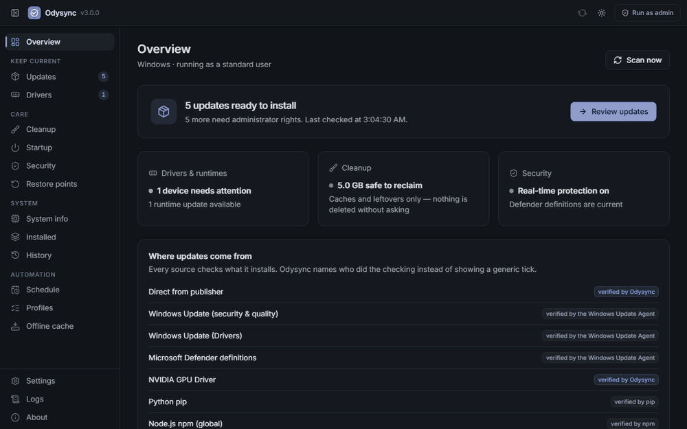
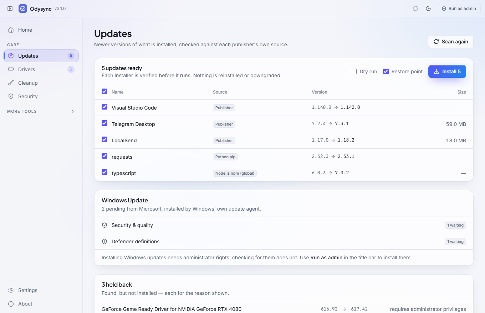
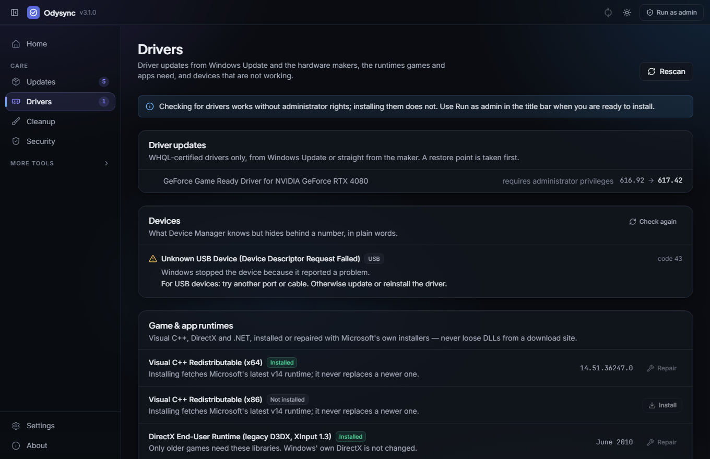
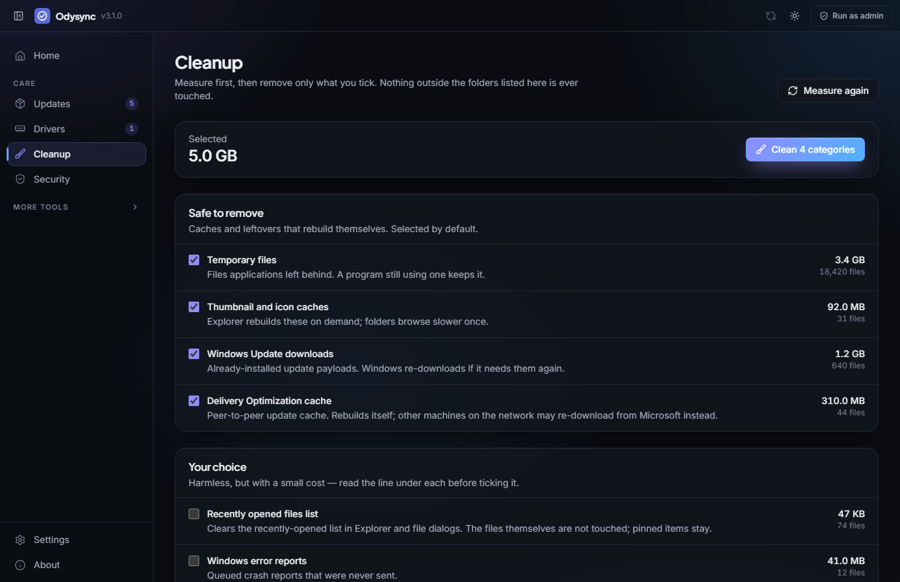
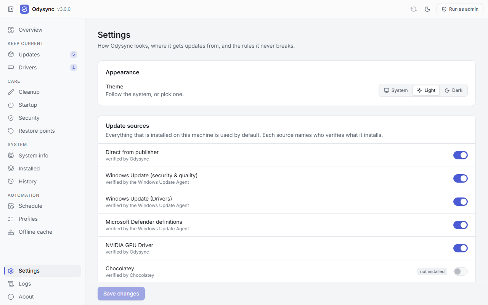
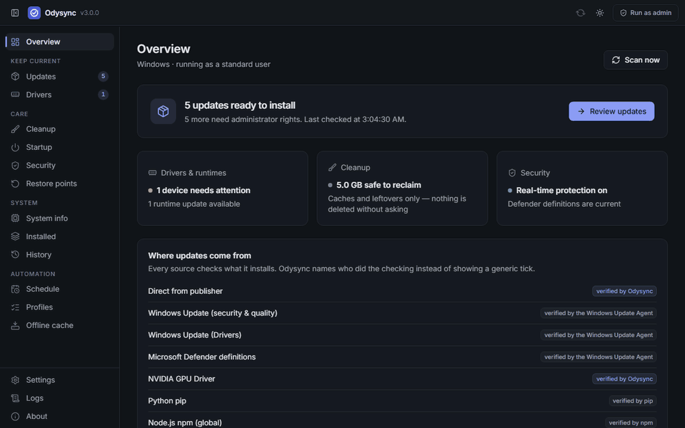
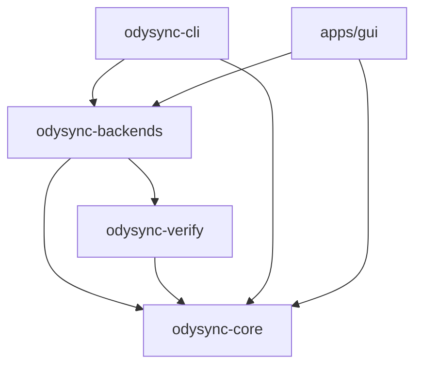

<div align="center">

<picture>
  <source media="(prefers-color-scheme: dark)" srcset="docs/assets/banner-dark.svg">
  <source media="(prefers-color-scheme: light)" srcset="docs/assets/banner-light.svg">
  
</picture>

<br>

[](https://github.com/SenseiIssei/Odysync/actions/workflows/rust.yml)
[](https://github.com/SenseiIssei/Odysync/releases/latest)
[](LICENSE)


**Odysync keeps programs, drivers, runtimes and the system itself up to date, cleans up what is safe to clean, and explains what it finds.**<br>
Free and open source, built around one rule: *never break a working machine.*

[**Download**](https://github.com/SenseiIssei/Odysync/releases/latest) · [Features](#features) · [How it stays safe](#how-it-stays-safe) · [Install](#install) · [CLI](#command-line) · [Build](#build-from-source)

<br>

<picture>
  <source media="(prefers-color-scheme: dark)" srcset="docs/assets/tour-dark.gif">
  <source media="(prefers-color-scheme: light)" srcset="docs/assets/tour-light.gif">
  
</picture>

</div>

<br>

## Why Odysync

Most "PC optimizer" suites mix a few genuinely useful tools with features that only look busy — registry cleaners, RAM boosters, "internet speed-ups" — and update drivers from their own repackaged databases. Odysync does the useful part, does it carefully, and leaves the rest out on purpose.

<table>
<tr>
<td width="50%" valign="top">

### 📦 Straight from the publisher
Installed programs are updated from their publishers' own GitHub releases and update feeds. **No dependency on winget** — winget, Chocolatey and Scoop are optional extra sources.

</td>
<td width="50%" valign="top">

### 🔏 Nothing runs unverified
Every installer Odysync downloads must carry a valid code signature *from the publisher it expects*. A valid signature from anyone else is refused.

</td>
</tr>
<tr>
<td width="50%" valign="top">

### ↩️ Never downgrade, never guess
A failed update stays failed; an unreadable version is a reason to skip, not to install. On Windows a restore point is taken first, and a driver backup is one setting away.

</td>
<td width="50%" valign="top">

### 🧾 Says who checked
Each source names who verified what it installs — *verified by Odysync*, *by the Windows Update Agent*, *by apt* — instead of a generic tick.

</td>
</tr>
</table>

## Features

| | Windows | macOS | Linux |
|---|:---:|:---:|:---:|
| **Programs, direct from the publisher** — signature-pinned installers from GitHub releases and vendor feeds | ✅ | ✅ Sparkle apps | — |
| **System package managers** — Homebrew, apt, dnf, pacman, zypper, Flatpak, Snap, Nix, Chocolatey, Scoop | ✅ | ✅ | ✅ |
| **Language ecosystems** — pip, npm, cargo, go, .NET tools, VS Code and JetBrains extensions | ✅ | ✅ | ✅ |
| **OS updates** — Windows Update (security, quality, Defender), `softwareupdate` | ✅ | ✅ | via package manager |
| **Drivers** — Windows Update drivers, NVIDIA straight from NVIDIA, OEM tools (Dell, HP, Lenovo…), `fwupd` firmware | ✅ | firmware | ✅ `fwupd` |
| **Driver backup and restore** — export the driver store, roll back after a bad update | ✅ | — | — |
| **Runtimes** — Visual C++, DirectX, .NET patches, from Microsoft's own installers | ✅ | — | — |
| **Device problems** — Device Manager error codes explained in plain words | ✅ | — | — |
| **Cleanup** — temp files, caches, trash, GPU shader caches, recent-files list; measure first, ask before anything permanent | ✅ | ✅ | ✅ |
| **Large files** — the biggest files in your home folder, report only | ✅ | ✅ | ✅ |
| **Startup manager** — turn sign-in programs off and back on, reversibly | ✅ | ✅ LaunchAgents | ✅ XDG autostart |
| **Security audit** — persistence, tampering, network exposure, hardening, Microsoft Defender | ✅ | — | — |
| **Restore points, disk optimisation, system file repair** | ✅ | — | — |
| **System info, schedules, profiles, update history** | ✅ | ✅ | ✅ |

Everything in the app is also in the CLI.

<table>
<tr>
<td width="50%"><p align="center"><sub><b>Updates</b> — what is ready, what is held back and why</sub></p></td>
<td width="50%"><p align="center"><sub><b>Drivers</b> — WHQL drivers, runtimes, device problems, backups</sub></p></td>
</tr>
<tr>
<td width="50%"><p align="center"><sub><b>Cleanup</b> — grouped by risk, measured before anything is deleted</sub></p></td>
<td width="50%"><p align="center"><sub><b>Settings</b> — optional sources, safety rules, theme</sub></p></td>
</tr>
</table>

### Light and dark



A calm interface with readable type and one accent colour. It follows your system theme, or you pick one in the title bar.

Navigation is grouped by what you want to do — *keep current*, *care*, *system*, *automation* — so the page you need is never more than one click away, and every page says in a sentence what it is for.

<br clear="right">

## How it stays safe

<picture>
  <source media="(prefers-color-scheme: dark)" srcset="docs/assets/verification-dark.svg">
  <source media="(prefers-color-scheme: light)" srcset="docs/assets/verification-light.svg">
  
</picture>

**Before an installer Odysync downloaded runs**, all of these must hold — each one is fatal on its own:

1. **Exact version.** The release is exactly the version you approved; if the publisher shipped another one in between, Odysync stops and asks for a new scan.
2. **Publisher URL.** The download belongs to the publisher the catalog names (a GitHub asset must be a release of *that* repository), over HTTPS on every redirect.
3. **Locked file.** The file is locked against writes and deletion, then re-hashed from disk — nothing can swap it between the check and the run, even when the installer runs elevated.
4. **SHA-256.** The hash matches whatever the source publishes (GitHub, VS Code and Node.js all publish one; .NET publishes SHA-512).
5. **Pinned signer.** The Authenticode signature is valid **and** issued to the expected publisher — parsed from the certificate subject, so `GitHub, Inc. Evil` does not pass for `GitHub, Inc.`.

Installers only run over an install of the same kind (MSI over MSI, Inno over Inno), never while the program is running. On macOS, an app update must carry a valid Ed25519 signature from the key *in the app you already have*, the same Apple Team ID, and Gatekeeper's approval; the old app is kept until the new one is in place.

### What Odysync deliberately does not do

| Feature found in optimizer suites | Why it is not here |
|---|---|
| 🚫 Registry cleaner | No measurable benefit on modern Windows; Microsoft does not support them and the failure mode is an unbootable system. |
| 🚫 RAM "booster" | Freeing working sets pushes pages to disk and makes the machine slower. |
| 🚫 "Internet boost" TCP tweaks | Windows auto-tunes TCP; the tweaks are folklore that can break networking. |
| 🚫 Drivers from a third-party database | Odysync uses Windows Update and the hardware makers only. |
| 🚫 Dropping "missing DLLs" into System32 | That is how DLL-download sites work; Odysync installs Microsoft's own runtime packages instead. |
| 🚫 Deleting browser history or cookies | That is your data, and browsers clear it correctly themselves. Odysync clears caches only. |
| 🚫 A startup "impact score" | Task Manager's score comes from undocumented telemetry; a number that disagrees with it is worse than none. |

## Install

Download the package for your system from the [**latest release**](https://github.com/SenseiIssei/Odysync/releases/latest). Every file has a `.sha256` next to it.

| System | App | CLI |
|---|---|---|
| 🪟 Windows 10/11 (x64) | `Odysync_<version>_x64-setup.exe` | `odysync-windows-x86_64.zip` |
| 🍎 macOS 11+ | `Odysync_<version>_aarch64.dmg` (Apple Silicon) | `odysync-macos-arm64.tar.gz`, `odysync-macos-x86_64.tar.gz` |
| 🐧 Linux (x64) | `.deb`, `.rpm` or `.AppImage` | `odysync-linux-x86_64.tar.gz` |

> [!NOTE]
> **The releases are not code-signed yet.** Windows SmartScreen will show "Windows protected your PC" — choose *More info → Run anyway* after checking the SHA-256. On macOS, open the app with right-click → *Open* the first time (or run `xattr -dr com.apple.quarantine /Applications/Odysync.app`). Signing is wired into the release workflow and switches on as soon as a certificate exists; see [docs/SIGNING.md](docs/SIGNING.md).

The app installs the CLI next to itself; scheduled runs use it.

## Command line

```sh
odysync scan                         # what can be updated, and what is held back and why
odysync apply                        # install everything that passes the safety rules
odysync apply --only vscode --yes    # one package, no prompt
odysync scan --backend direct        # ask one source only (naming an opt-in source enables it for this run)

odysync clean                        # measure reclaimable space; deletes nothing
odysync clean --apply                # remove the safe-by-default categories
odysync large-files --min-mb 500     # the biggest files in your home folder

odysync drivers backup               # export the driver store (Windows)
odysync components                   # Visual C++, DirectX and .NET status (Windows)
odysync devices                      # devices Windows reports as not working
odysync startup                      # programs that start at sign-in
odysync sysinfo                      # processor, memory, graphics, disks

odysync hold vscode                  # never update this one
odysync schedule --frequency daily --time 09:00
odysync backends                     # every source, and who verifies what it installs
```

`odysync --help` and `odysync <command> --help` list everything; `--json` gives machine-readable output.

## Build from source

Requirements: Rust 1.90+, Node.js 22+, and on Linux the [Tauri prerequisites](https://v2.tauri.app/start/prerequisites/).

```sh
cargo build --release -p odysync-cli          # the CLI, in target/release/
cd apps/gui && npm ci && npx tauri dev        # the app, with hot reload
npm run dev                                   # the UI alone in a browser, on demo data
```

Tests and lints, as CI runs them:

```sh
cargo fmt --all -- --check
cargo clippy --workspace --all-targets -- -D warnings
cargo test --workspace --lib
cd apps/gui && npx tsc -b && npx oxlint && npm test
```

CI runs all of this on Windows, macOS and Linux, builds and starts the CLI and the packaged app on all three, and adds `cargo audit`, `cargo deny`, `npm audit` and a CycloneDX SBOM.

## Architecture



| Crate | What it does |
|---|---|
| `odysync-core` | Domain model, version algebra, safety policy, planner, runner |
| `odysync-verify` | SHA-256 and platform code-signature checks (Authenticode, `codesign`) |
| `odysync-backends` | Every update source, cleanup, drivers, runtimes, startup, system info |
| `odysync-cli` | The `odysync` command |
| `apps/gui` | The desktop app: Tauri 2, React 19, TypeScript 7, Tailwind 4 |

Every safety decision lives in `odysync-core`, which is pure, fully unit-tested and knows no package manager. The CLI and the app are thin shells over the same engine and cannot disagree about what is safe. Adding an update source means implementing one five-method trait. See [ARCHITECTURE.md](ARCHITECTURE.md).

## License

[MIT](LICENSE) © SenseiIssei

<div align="center">
<br>
<a href="https://ko-fi.com/senseiissei"></a>
</div>
